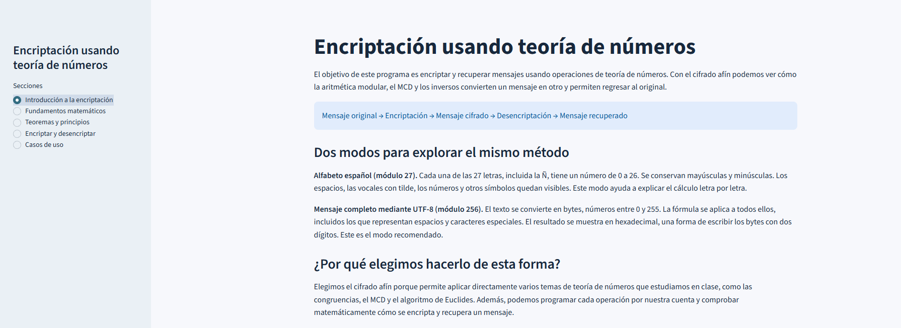
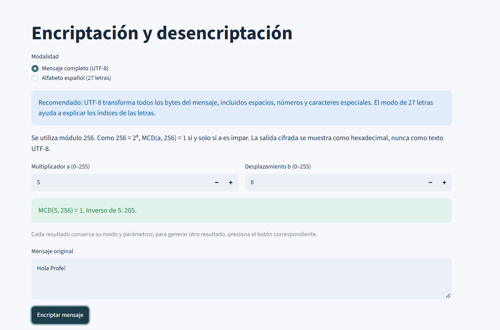
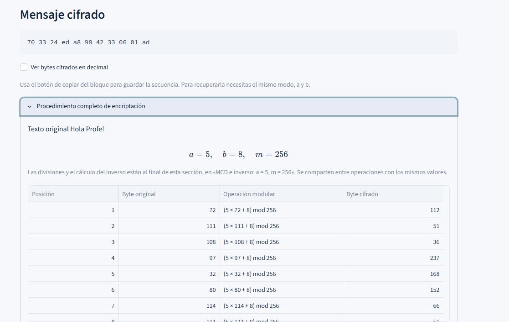
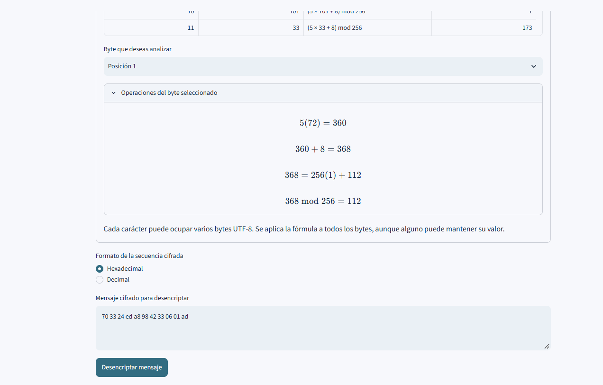
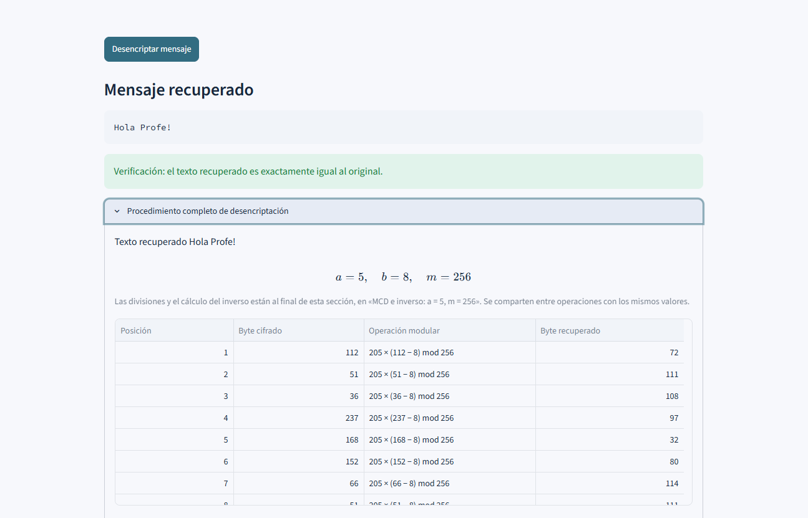
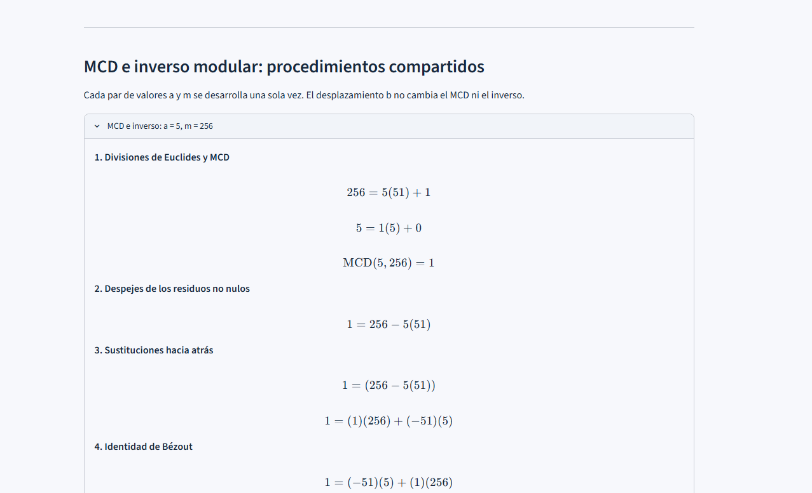

# Encriptación usando teoría de números


## Ejecutar en Windows

Con Python 3.12, desde esta carpeta:

```powershell
python -m venv .venv
.\.venv\Scripts\python.exe -m pip install -r requirements.txt
.\.venv\Scripts\python.exe -m streamlit run app.py
```

Si Streamlit ya está instalado: `python -m streamlit run app.py`. Abre la dirección local indicada (normalmente http://127.0.0.1:8501). Ctrl+C detiene el servidor. En VS Code selecciona el intérprete de `.venv`. Tras instalar las dependencias no hace falta internet. Contenido español de Guatemala (`es-GT`) y archivos UTF-8; los controles internos dependen del soporte de idioma del framework.

## Visualización


### Introducción



### Encriptación y desencriptación

#### Captura 1


#### Captura 2


#### Captura 3


#### Captura 4


#### Captura 5

